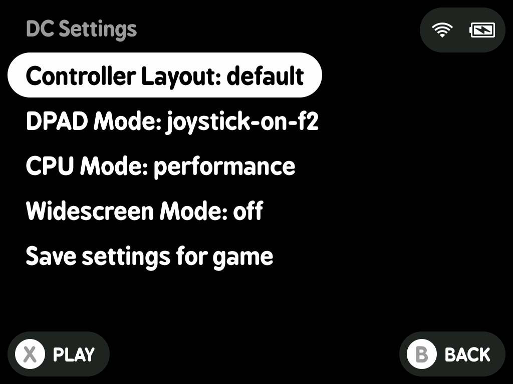

# minui-dreamcast.pak

A MinUI Emu Pak for Dreamcast, wrapping the standalone `flycast` Dreamcast emulator (version `7d64554`).

## Requirements

This pak is designed and tested on the following MinUI Platforms and devices:

- `tg5040`: Trimui Brick (formerly `tg3040`)
- `h700`: Anbernic H700 devices (RG35XX/RG40XX series) running NextUI

Use the correct platform for your device.

## Installation

1. Mount your MinUI SD card.
2. Download the latest release from Github. It will be named `DC.pak.zip`.
3. Copy the zip file to `/Emus/$PLATFORM/DC.pak.zip`.
4. Extract the zip in place, then delete the zip file.
5. Confirm that there is a `/Emus/$PLATFORM/DC.pak/launch.sh` file on your SD card.
6. Create a folder at `/Roms/Sega Dreamcast (DC)` and place your roms in this directory.
7. Copy your BIOS files to `/BIOS/DC`. The paths are as follows
    1. Dreamcast: `/BIOS/DC/dc_boot.bin`
    2. Naomi: `/BIOS/DC/naomi.zip`
8. Unmount your SD Card and insert it into your MinUI device.

## Usage

Browse to `Sega Dreamcast` and press `A` to play a game.

The following filetypes are supported:

- Native: `.cdi`, `.chd`, `.cue and .bin`, `.gdi and .bin.`

### Controller Layouts

#### Default Controller Layout

Dreamcast Controller Keys:

| Hardware Button | Dreamcast Mapping |
|-----------------|-------------|
| `L1`            | `L`         |
| `R1`            | `R`         |
| `A`             | `B`         |
| `B`             | `A`         |
| `X`             | `Y`         |
| `Y`             | `X`         |

| Action                  | Hardware Combination   |
|-------------------------|------------------------|
| MinUI Menu Resume State | `X`                    |
| Quit Game               | `MENU`                 |
| Flycast Menu            | `SELECT`               |
| Fast Forward            | `R2`                   |
| Load State              | `L3`, or `HOTKEY 1`    |
| Save State              | `R3`, or `HOTKEY 2`    |
| Screenshot              | `L2`                   |

### Emulator settings

To change emulator settings, press and hold the `R2` button while selecting/resuming a game to play. Hold R2 until a menu appears.

If the `B` or `MENU` buttons are pressed, the user is returned to the MinUI game selection screen. Settings are managed on a per-game basis, and can be saved for future gameplay, or the game can be started with the current settings as is.

To start a game in this menu, press the `X` button. Any settings currently selected will be used for the game session.

Settings in this menu can be saved by selecting `Save settings for game` and pressing the `A` button. This will save the settings and bring the user back to the menu. The `X` button can be pressed to start the game.

This pak also ships with some default Flycast settings. Users may edit these settings in the in-emulator settings menu, and they will persist across game sessions. To reset these settings to the ones shipped with Flycast, select `Re-apply default flycast settings` and press the `A` button.

#### Controller Layout

Allows changing between controller layouts.

- default: `default`
- options: `default`, `custom`

If `default` is set, the pak will reset the settings to the built-in controller mapping on boot.

Flycast names its mapping file after the SDL joystick name, which is not the same
on every platform, so the pak writes the layout under the name flycast reads on
`h700`.

When `custom` is selected, users will be allowed to customize their controller layout and have that persist across game starts. These settings will also be stored in a per-game path, and restored when that same game is played again.

#### CPU Mode

Allows changing the CPU Mode the emulator uses at runtime.

- default: `performance`
- options: `ondemand`, `performance`

#### DPAD Mode

Allows changing how the dpad is used in game.

- default: `dpad`
- options: `dpad`, `joystick`, `joystick and dpad`, `joystick on f2`

> [!NOTE]
> On `h700` only `dpad` and `joystick` are offered. The other two modes need
> Trimui's `trimui_inputd`, which h700 does not have.
>
> `joystick` is also applied differently. On `tg5040` the input daemon redirects
> the dpad to the stick. On `h700` the pak rewrites the flycast mapping instead,
> and what it writes depends on whether the model has an analog stick:
>
> - **With a stick** (`rg34xxsp`, `rg35xxh`, `rg35xxpro`, `rg40xxh`, `rg40xxv`,
>   `rgcubexx`) the two are exchanged: the dpad drives the Dreamcast analog
>   stick and the physical stick drives the Dreamcast dpad. Use the stick to
>   navigate the flycast menu while this mode is on.
> - **Without a stick** the dpad drives the Dreamcast analog stick and nothing
>   drives the Dreamcast dpad. Flycast's own menu only moves between items on
>   dpad input, so **it cannot be navigated in this mode**. This is the same
>   trade `tg5040` makes with `input_no_dpad`. `MENU` still quits the game, and
>   holding `R2` at launch still opens this pak's settings menu, so the mode can
>   always be turned back off.

#### Widescreen Mode

> [!NOTE]
> See [this document](https://forums.launchbox-app.com/topic/65672-169-sega-dreamcast-via-flycast-norms-true-anamorphic-widescreen-project/) for details on how Dreamcast handles widescreen mode.

Allows toggling between widescreen modes

- default: `off`
- options: `off`, `on`, `cheat`

### Save states

In addition to in-game saves, this pak supports a single save state. Save states are stored in `$SDCARD_PATH/.userdata/shared/DC-flycast`

### Screenshots

Screenshots are written to `/Screenshots` with a sanitized version of the rom name as the screenshot prefix.

### Sleep Mode

Built-in MinUI cores have support for turning off the display and eventually shutting down when the power button is pressed. Standalone emulators do not have this functionality due to needing support inside of the console for this. At this time, this pak does not implement sleep mode.

### Debug Logging

Debug logs are written to the`$SDCARD_PATH/.userdata/$PLATFORM/logs/` folder.

## Screenshots

| Name               | Image                                                     |
|--------------------|-----------------------------------------------------------|
| Emulator Settings  |  |
